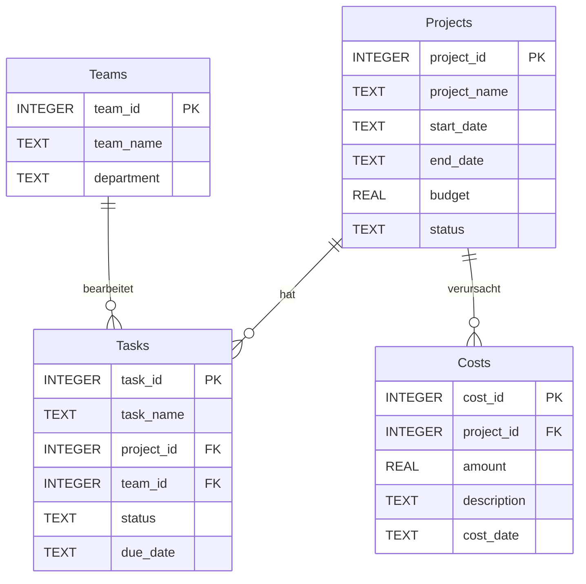

# IT-Project-Management

Eine relationale SQLite-Datenbank zur Verwaltung von IT-Projekten: Projekte, Teams, Aufgaben und Kosten.

Ich habe das Projekt von Grund auf selbst geplant und umgesetzt, um relationale Datenmodellierung und SQL in der Praxis zu üben.

## Was kann man damit machen?

- Projekte mit Zeitraum, Budget und Status verwalten
- Aufgaben einem Projekt und einem Team zuordnen
- Kosten pro Projekt erfassen
- Auswerten, wie viel Budget ein Projekt schon verbraucht hat

## Datenmodell

Die Datenbank besteht aus vier Tabellen:

| Tabelle    | Inhalt                                   | Primary Key  | Foreign Keys                                    |
|------------|------------------------------------------|--------------|-------------------------------------------------|
| `Projects` | Name, Start, Ende, Budget, Status        | `project_id` | –                                               |
| `Teams`    | Teamname, Abteilung                      | `team_id`    | –                                               |
| `Tasks`    | Aufgabe, Status, Fälligkeitsdatum        | `task_id`    | `project_id` → `Projects`, `team_id` → `Teams`  |
| `Costs`    | Betrag, Beschreibung, Datum              | `cost_id`    | `project_id` → `Projects`                       |



## Beispielabfragen

Alle Abfragen stehen in [`queries.sql`](queries.sql). Zwei Beispiele:

**Aufgaben mit Projekt und Team (JOIN)**

```sql
SELECT t.task_name, p.project_name, tm.team_name, t.status
FROM Tasks t
JOIN Projects p ON t.project_id = p.project_id
JOIN Teams tm   ON t.team_id    = tm.team_id;
```

**Restbudget pro Projekt (LEFT JOIN + GROUP BY)**

```sql
SELECT p.project_name,
       p.budget,
       COALESCE(SUM(c.amount), 0)            AS kosten,
       p.budget - COALESCE(SUM(c.amount), 0) AS rest_budget
FROM Projects p
LEFT JOIN Costs c ON p.project_id = c.project_id
GROUP BY p.project_id, p.project_name, p.budget;
```

| project_name       | budget  | kosten | rest_budget |
|--------------------|---------|--------|-------------|
| Database Migration | 30000.0 | 8000.0 | 22000.0     |
| Website Redesign   | 50000.0 | 15000.0| 35000.0     |
| Mobile App         | 120000.0| 45000.0| 75000.0     |

## So startest du das Projekt

1. Repository klonen:
   ```bash
   git clone https://github.com/wiamsahli/IT-Project-Management.git
   ```
2. `IT_Project_Management.db` mit [DB Browser for SQLite](https://sqlitebrowser.org/) öffnen.
3. Im Tab **„SQL ausführen“** die Abfragen aus `queries.sql` einfügen und starten.

## Verwendete Technologien

- SQLite
- DB Browser for SQLite
- SQL (CREATE, INSERT, UPDATE, DELETE, SELECT, JOIN, GROUP BY)
- Git und GitHub

## Nächste Schritte

- Weboberfläche bauen, zum Beispiel mit Laravel, damit man Projekte im Browser verwalten kann
- Eingaben mit Prepared Statements absichern (Schutz vor SQL-Injection)
- Status-Werte mit einer Tabelle oder einem `CHECK`-Constraint einheitlich machen
